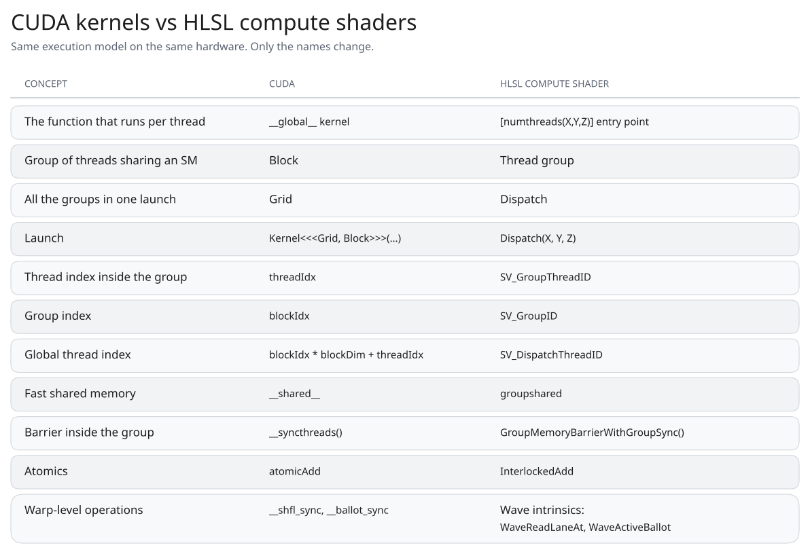
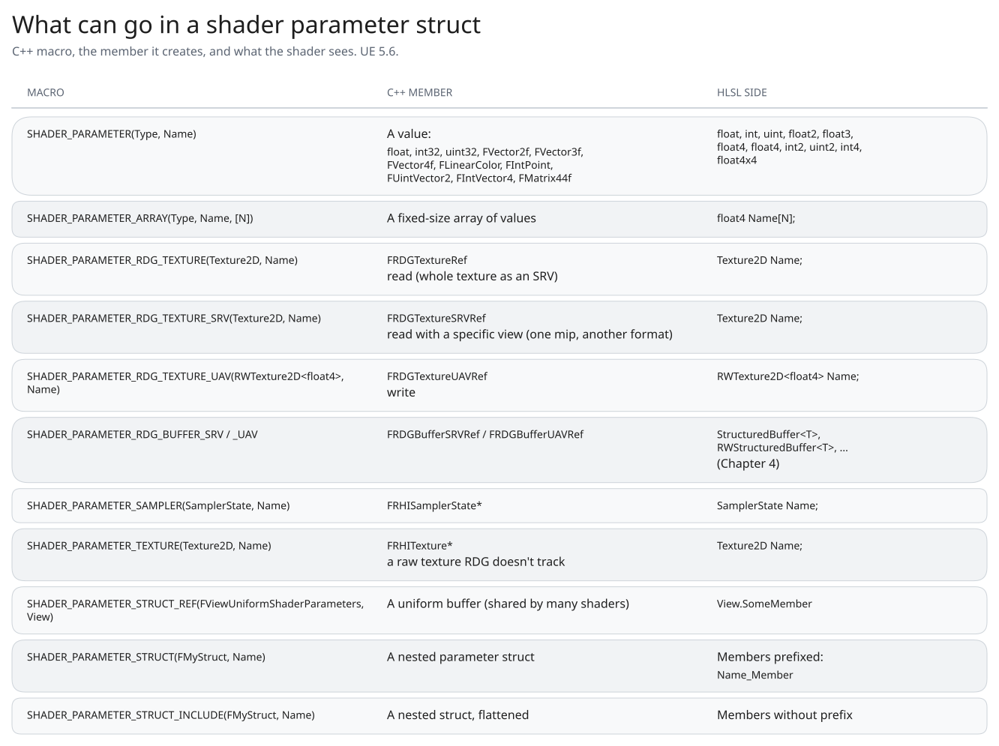

This chapter deals with compute shaders, including writing a shader in a plugin, sending it through the Render Dependency Graph, and carrying out general-purpose work on the GPU.

In chapter 2 we just looked into rendering pipeline and how to insert our compute shader work into various stages of rendering pipeline via SVE (Scene view extension) hooks.

In this chapter, we will study the companion plugin and see how to create a compute shader from scratch, gain sufficient knowledge of HLSL to be able to read and write one, understand the difference between an SRV and a UAV, fill in a parameter struct, and add the shader to the Render Dependency Graph; afterwards we'll keep going all the way down to warps being executed on an SM. Along the way we'll look at the thing which confused me most: why can't the Unreal Material Editor do some things????

All the examples are from the companion plugin, `UEGraphicsProgramming` (<https://github.com/Saish-in3d/UEGraphicsProgramming.git>), plus `FCompositorCS` from Chapter 2. Engine code is from UE 5.6.

## 1. Back to the warp
In Chapter 1 we saw that the GPU does not schedule threads one by one. Threads are bundled into groups of 32 (a warp on NVIDIA) or 32/64 (a wavefront on AMD), and every thread in the group runs the same instruction at the same time, each on its own data.

`There are two consequences that come up constantly in shader code.`

The first is **`divergence`**. If there is a branch in the code with different results, the hardware will run part of group one branch result first and then other. Till then other part of group stays idle. Same with loop, shortest loop thread has to wait for longest running loop.

The second is how the GPU deals with slow memory.(`Occupancy`)

A GPU doesn't try to hide memory latency only with large caches and prediction. It also hides it by keeping lots of work ready to run. When a warp stalls waiting for a texture fetch or buffer read, which can take hundreds of cycles, the scheduler can issue instructions from another warp that is ready to go.

This works because the GPU keeps multiple warps resident on an SM. The more warps it can keep resident (inside register or shared memory on SM), the more opportunities it has to find other work when one warp is waiting.

 `Occupancy` is basically how many warps are resident compared with the maximum the hardware can support. Registers and shared memory are two of the resources that limit this. If each thread uses a lot of registers, or each group uses a lot of shared memory, fewer warps can fit on the SM. Eventually, there may not be enough other work available to hide the memory latency.

This is also where the thread group in a compute shader comes in.

When you write `[numthreads(8, 8, 1)]` in HLSL, you're creating a group of 64 threads. The threads in a group are scheduled together on the same SM/CU, so they can use `groupshared` memory and synchronise with each other. Threads belonging to different groups don't have that same guarantee.

The `group size` also matters for how efficiently the GPU uses its execution lanes. A 64-thread group maps nicely to common hardware: two NVIDIA warps or one AMD wave64. In general, you want the group size to work well with the hardware's warp/wave size so you don't end up with unused lanes.

Take a 1920×1080 image where we want one compute shader thread to process each pixel.

We can define the thread group as:

```hlsl
[numthreads(8, 8, 1)]
```

That's 64 threads per group. Since the image is 1920 pixels wide, we need `1920 / 8 = 240` groups in X. For the height, `1080 / 8 = 135` groups in Y.

So the dispatch becomes:

```cpp
Dispatch(240, 135, 1);
```

That gives us:

```text
240 × 135 groups × 64 threads
= 2,073,600 threads
```

which is exactly the number of pixels in a 1920×1080 image.

If we instead use:

```hlsl
[numthreads(16, 16, 1)]
```

each group contains 256 threads. We need 120 groups in X, but `1080 / 16 = 67.5`, so we have to round up to 68 groups in Y:

```cpp
Dispatch(120, 68, 1);
```

This launches slightly more threads than there are pixels, so the shader needs a bounds check for the threads that fall outside the image.

The important part is that `numthreads` defines the size of **one group**, while `Dispatch` defines how many groups we launch. Together they determine the total number of threads that actually run.

### 1.1 The GPU memory hierarchy
GPU has their more memory which has more bandwidth than RAM, roughly around 5-10 times more. Even tho there is high bandwidth, there is latency issue around few hundred GPU cycles. This is where occupancy matters and there is scope of optimization.

GPU bandwidth totally depend on layout of required memory. Accessing memory that is adjacent to each other by 32 threads in a warp is faster as it can be done in a single memory transaction. But if data is randomly stored in 3d random places inside memory, more memory transactions are required making entire operation slower. In libraries like Vulkan we need to define the access memory layout in the pipeline before submitting work to GPU.

<figure class="diagram"><a href="/assets/diagrams/gpu-memory-hierarchy.svg" title="Open full size"></a></figure>

Above diagram is of GPU memory hierarchy, our goal is to keep the frequently used memory closer to the thread/computation.

We can control where the data is stored in memory hierarchy at certain levels to a extent via through local variables and `groupshared` memory.

GPU memory optimization is largely about:

1. Keep frequently reused data close to the computation
2. Minimize expensive VRAM accesses
3. Keep data together in VRAM memory
4. Reuse data from caches/on-chip memory
5. Don't use so many registers/shared memory that occupancy suffers

I keep this hierarchy in the back of my head. Almost every "why is my compute shader slow" question I've had ended up at one of these levels.

There is also a tradeoff related to occupancy, using more registers or `groupshared` memory can make individual accesses faster, but it also consumes limited SM resources and can reduce the number of warps on the memory of SM. 

## 2. CUDA kernels and compute shaders are the same idea
As I mentioned in the prologue, a lot of what I knew from CUDA carried straight over. If you've written CUDA, you already know how to write a compute shader. The execution model is the same, you write one function, the *kernel*, and launch a grid of threads that all run it on different data. Only the names change.

<figure class="diagram"><a href="/assets/diagrams/ch3-cuda-vs-hlsl.svg" title="Open full size"></a></figure>

It's the same hardware, both end up as a warp on same SMs. Only difference with compute shaders is that they live inside a rendering pipeline context. CS are passed into commandlist/comandbuffer inside queue or a pool (of underlying graphics library) and submitted to GPU along with access to textures like scene color and depth stencils. CUDA has a separate Nvidia hardware only context with raw GPU pointers wrapped Nvidia specific data structures and layouts.

My rule of thumb: if the work is part of rendering a frame, or needs the frame's textures, I use a compute shader. For a big standalone numerical job, CUDA is often nicer.

## 3. HLSL, scratching the surface
I won't try to teach all of HLSL here. It's C-like, and these are the things I wish someone had told me up front.  LLMs write good HLSL, you just need to optimize your system/business logic and keep profiling to improve.

It has vector and matrix types (`float2` to `float4`, `int2`, `float4x4`) with swizzling (`Color.rgb`), and math on them is component-wise. Variables declared at file scope are the shader's parameters: read-only, the same for every thread, and bound by name to the C++ parameter struct. The compiler gathers them into a **constant buffer**, a small block of GPU memory that every thread reads the same values from (Chapter 4 looks at how it's laid out). Read-only resources (`Texture2D`) are bound through SRVs and writable ones (`RWTexture2D`) through UAVs. The entry point carries `[numthreads(X, Y, Z)]` (at most 1024 threads and 32 KB of `groupshared` memory per group), and `SV_DispatchThreadID = SV_GroupID * numthreads + SV_GroupThreadID`, which for image work *is* the pixel coordinate. The one that surprised me: `Sample` isn't available in compute, because a thread has no neighboring pixels to work out a mip level from, so you use `SampleLevel` or `Load`. And never put `GroupMemoryBarrierWithGroupSync()` inside a branch that only some threads take. On the Unreal side, includes use virtual paths (`/Engine/Public/Platform.ush`, `/Engine/Private/Common.ush`), defines like `THREADS_X` come from `ModifyCompilationEnvironment`, and the `shared` you'll see on my plugin's outputs is a leftover hint the compiler ignores, not `groupshared`. For everything else, I keep Microsoft's [HLSL reference](https://learn.microsoft.com/en-us/windows/win32/direct3dhlsl/dx-graphics-hlsl-intrinsic-functions) open.


## 4. SRVs, UAVs and views
HLSL splits resources into read-only ones (`Texture2D`) and writable ones (`RWTexture2D`). On the C++ side, that distinction is called SRV and UAV, and it confused me for a while because the names don't say much.

What finally made it click was realising that a shader never binds the memory itself. A texture in VRAM is just memory with a format and a size. Shader just binds a **view** which is just a small description that says "look at this resource this way" (which mips, which format, and whether you're allowed to write).

- **SRV, Shader Resource View.** A read-only view. In HLSL that's `Texture2D`, `Buffer`, `StructuredBuffer`. Can be sampled with filtering.
- **UAV, Unordered Access View.** A read-write view. In HLSL that's `RWTexture2D`, `RWBuffer`, `RWStructuredBuffer`. "Unordered" means threads can read and write any location in any order, with no guarantee about who goes first. That's what makes scatter writes possible, and also why two threads writing the same pixel need atomics.

Why have two kinds at all? Because the GPU treats them differently. Read-only data can be cached aggressively and filtered by the texture units. Writable data can't be cached the same way, since another thread might change it. And before a texture that was just written as a UAV can be read as an SRV, the GPU has to finish the writes and flush caches. That's a **barrier** (a resource transition). In raw D3D12 or Vulkan you'd write every one of those by hand. In Unreal, RDG does it for you, which I'll get to below.

Two practical rules I learned from this:

- **A texture or a render target asset needs to be created with UAV flag support to get a UAV.** For a texture RDG creates, that's the `TexCreate_UAV` flag. For a `UTextureRenderTarget2D` it's `bCanCreateUAV`, which is off by default. In my plugin, `ABasePlane` turns it on when it creates the render target the lessons write into:

  ```cpp
  // BasePlane.cpp
  TempOutputRenderTarget = NewObject<UTextureRenderTarget2D>(this);
  TempOutputRenderTarget->InitCustomFormat(RenderTargetResolution.X, RenderTargetResolution.Y,
      RenderTargetPixelFormat, true);            // 256x256, PF_FloatRGBA
  TempOutputRenderTarget->bAutoGenerateMips = false;
  TempOutputRenderTarget->bCanCreateUAV = true;  // without this, CreateUAV fails
  TempOutputRenderTarget->UpdateResourceImmediate();
  ```
- **You can't read a texture through an SRV and write it through a UAV in the same pass.** as SRV and UAVs are just "views" to texture memory and underlying texture memory resource is the same.

## 5. My first compute shader: FS1L1
Time for real code. I'm assuming you know the the plugin setup from Chapter 1... the rendering modules in `Build.cs`, the `PostConfigInit` loading phase, and the `/Plugins/UEGraphicsProgramming` shader path mapping. The first lesson in my plugin writes a pattern into a 256×256 render target. One thread per pixel, 8×8 threads per group, no inputs at all.

### 5.1 The HLSL
```hlsl
// Shaders/FS1L1_FirstComputeShaderCS.usf
#include "/Engine/Public/Platform.ush"
#include "/Engine/Private/Common.ush"
#include "/Engine/Private/ScreenPass.ush"

shared RWTexture2D<float4> FS1L1_Output;

[numthreads(THREADS_X,THREADS_Y,THREADS_Z)]
void FS1L1_FirstComputeShaderCS(uint2 DispatchThreadId : SV_DispatchThreadID)
{
    //Drawing Sierpinski Triangle
    FS1L1_Output[DispatchThreadId.xy] = float4(DispatchThreadId.x & DispatchThreadId.y,(DispatchThreadId.x & 15)/15.0,
        (DispatchThreadId.y & 15)/15.0,0.0);
}
```

Every thread computes one pixel from nothing but its own coordinate:

- **Red** is `x & y`, a bitwise AND. It's zero exactly where x and y share no set bits, and those pixels form a Sierpinski triangle. Everywhere else it's a positive integer, which shows as full red.
- **Green** is `(x & 15) / 15`, a ramp from 0 to 1 that repeats every 16 pixels. `& 15` is the same as `% 16` for unsigned numbers, just cheaper.
- **Blue** is the same ramp along y.

It's a tiny shader, but it's already the whole model, and it's the moment the idea landed for me: there's no loop over pixels anywhere. The loop is the dispatch.

### 5.2 The C++ shader class
This is kinda boring part with lots of boilerplate code that can be automated with LLMs. It's just like filling a form

```cpp
// Public/Section_1/S1L1_FirstComputeShader.h
#include "CoreMinimal.h"
#include "DataDrivenShaderPlatformInfo.h"
#include "ShaderParameterStruct.h"

class UEGRAPHICSPROGRAMMING_API FS1L1_FirstComputeShaderCS : public FGlobalShader
{
public:
    DECLARE_GLOBAL_SHADER(FS1L1_FirstComputeShaderCS)
    SHADER_USE_PARAMETER_STRUCT(FS1L1_FirstComputeShaderCS, FGlobalShader)

    BEGIN_SHADER_PARAMETER_STRUCT(FParameters,)
        SHADER_PARAMETER_RDG_TEXTURE_UAV(RWTexture2D<float4>, FS1L1_Output)
    END_SHADER_PARAMETER_STRUCT()

    // Basic shader initialization
    static bool ShouldCompilePermutation(const FGlobalShaderPermutationParameters& Parameters)
    {
        return IsFeatureLevelSupported(Parameters.Platform, ERHIFeatureLevel::SM5);
    }

    // Define environment variables used by compute shader
    static void ModifyCompilationEnvironment(const FGlobalShaderPermutationParameters& Parameters,
        FShaderCompilerEnvironment& OutEnvironment)
    {
        OutEnvironment.SetDefine(TEXT("THREADS_X"), 8);
        OutEnvironment.SetDefine(TEXT("THREADS_Y"), 8);
        OutEnvironment.SetDefine(TEXT("THREADS_Z"), 1);
    }

    static void FS1L1_FirstCSRun(UTextureRenderTarget2D* OutputRenderTarget);
};

// Private/Section_1/S1L1_FirstComputeShader.cpp
IMPLEMENT_GLOBAL_SHADER(FS1L1_FirstComputeShaderCS, "/Plugins/UEGraphicsProgramming/FS1L1_FirstComputeShaderCS.usf",
                        "FS1L1_FirstComputeShaderCS", SF_Compute);
```

This is a lot of macros for a shader with one output, so here's how I read it, piece by piece:

- **`FGlobalShader`.** A shader that isn't tied to a material or a mesh, with one instance per permutation in the global shader map.
- **`DECLARE_GLOBAL_SHADER` / `IMPLEMENT_GLOBAL_SHADER`.** Tie the class to the `.usf` virtual path, the entry point function and the stage (`SF_Compute`). A path that doesn't resolve fails here, at editor startup.
- **`BEGIN_SHADER_PARAMETER_STRUCT`.** Generates the C++ struct plus reflection metadata (name, type and byte offset of every member). That metadata is how RDG finds every resource inside the struct.
- **`SHADER_USE_PARAMETER_STRUCT`.** Binds the class to its `FParameters`. One parameter struct per shader.
- **`ShouldCompilePermutation` / `ModifyCompilationEnvironment`.** Which platforms compile it (SM5 and up), and the `THREADS_X/Y/Z` defines used by `[numthreads]`.

`FS1L1_FirstCSRun` is just a helper I wrote to run the shader; I'll get to it in section 6. What won me over to the macro system is validation: the shader compiler checks the struct against what the shader actually declares, so a typo in C++ becomes an error message instead of a black screen.

### 5.3 Adding parameters: FS1L2 to FS1L4
**FS1L2 (Clear color)** writes `float4(1,0,0,1)` to every pixel. It's boring on purpose: I run it first in later lessons, to wipe the render target before drawing into it.

**FS1L3 (Split screen)** gets its first value parameter:

```hlsl
shared RWTexture2D<float4> FS1L3_Output;
int TextureResolution;

[numthreads(THREADS_X,THREADS_Y,THREADS_Z)]
void FS1L3_SplitScreenCS(uint2 DispatchThreadId : SV_DispatchThreadID)
{
    //Bitshifting the TextureResolution value to divide by 2
    int HalfRes = TextureResolution >> 1;

    //Using Step(ValueA,valueB) if ValueA >= ValueB then return 1 else return 0
    FS1L3_Output[DispatchThreadId.xy] = float4(step(HalfRes,DispatchThreadId.x),step(HalfRes,DispatchThreadId.y),
        0,1);
}
```

```cpp
BEGIN_SHADER_PARAMETER_STRUCT(FParameters,)
    SHADER_PARAMETER_RDG_TEXTURE_UAV(RWTexture2D<float4>, FS1L3_Output)
    SHADER_PARAMETER(int, TextureResolution)
END_SHADER_PARAMETER_STRUCT()
```

`SHADER_PARAMETER(int, TextureResolution)` on the C++ side, `int TextureResolution;` in HLSL, matched by name. `step()` splits the texture into four quadrants without a single `if`: red turns on past the middle in x, green past the middle in y. Replacing branches with `step`, `lerp` and `saturate` is a habit I'd recommend building early, because of divergence.

**FS1L4 (Solid circle)** draws a filled circle the way a pixel shader would, by having every pixel measure its distance to the center:

```hlsl
shared RWTexture2D<float4> FS1L4_Output;
int CircleRadius;

[numthreads(THREADS_X,THREADS_Y,THREADS_Z)]
void FS1L4_SolidCircleCS(uint2 DispatchThreadId : SV_DispatchThreadID)
{
    //This kernel only works properly when I cast some values to float or float2 else I get 1/4th of circle on texture
    float CircleRadiusInt = (float2)CircleRadius;
    uint2 Centre = uint2(256 >> 1,256 >> 1);
    float2 ThreadPointLocationFromCentre = (float2)((int2)(DispatchThreadId.xy - Centre));
    float PointDistancefromcentre = (float2)(abs(length(ThreadPointLocationFromCentre)));

    FS1L4_Output[DispatchThreadId.xy] = float4(step(CircleRadiusInt,PointDistancefromcentre),
        step(CircleRadiusInt,PointDistancefromcentre),
        1.f,1.f);
}
```

That comment at the top is a lesson I learned the hard way. `DispatchThreadId` and `Centre` are both `uint2`. For pixels left of or above the center, `DispatchThreadId.xy - Centre` is negative, and a negative number in an *unsigned* type wraps around to a huge positive one (4 billion and something). The distance comes out enormous, and only the bottom-right quarter of the circle survives. Casting to `int2` *before* doing anything else with the result turns the wrapped value back into the right negative number. Mixing signed and unsigned is still the most common HLSL bug I write.

Keep FS1L4 in mind. It's the "gather" version of a circle, and I'll compare it with a very different circle shader soon.

### 5.4 What can go in a parameter struct
<figure class="diagram"><a href="/assets/diagrams/ch3-shader-parameter-macros.svg" title="Open full size"></a></figure>

None of my plugin's Section 1 lessons *read* a texture. For that, I'll go back to Chapter 2's compositor, which reads three textures and writes one. Its parameter struct uses most of the table above:

```cpp
// GPUCompositionGraphicsPipeline: CommonStructs.h
BEGIN_SHADER_PARAMETER_STRUCT(FCompositorStruct,)
    SHADER_PARAMETER_STRUCT_REF(FViewUniformShaderParameters, View)
    SHADER_PARAMETER_STRUCT(FScreenPassTextureViewportParameters, ViewportSceneParameters)
    SHADER_PARAMETER_RDG_TEXTURE(Texture2D, ViewportSceneColor)
    SHADER_PARAMETER_RDG_TEXTURE_SRV(Texture2D<uint>, MaskInputTexture)
    SHADER_PARAMETER_RDG_TEXTURE(Texture2D, MediaTexture)
    SHADER_PARAMETER_RDG_TEXTURE_UAV(RWTexture2D<float4>, CompOutput)
    SHADER_PARAMETER(int,TransparentBase)
    SHADER_PARAMETER(float,StageOneValue)
    SHADER_PARAMETER(float,StageTwoValue)
END_SHADER_PARAMETER_STRUCT()

// CompositorCS.h
class GPUCOMPOSITIONGRAPHICSPIPELINE_API FCompositorCS : public FGlobalShader
{
    DECLARE_GLOBAL_SHADER(FCompositorCS)
    using FParameters = FCompositorStruct;
    SHADER_USE_PARAMETER_STRUCT(FCompositorCS, FGlobalShader)
    // ... ShouldCompilePermutation, ModifyCompilationEnvironment (CompTHREADS_X/Y/Z = 8, 8, 1)
};
```

Two things are new here. I declared the struct outside the class and plugged it in with `using FParameters = FCompositorStruct;`, which is handy when several shaders or helper functions share it. And it has three different kinds of read:

**`View`** is the view uniform buffer. A **uniform buffer** is a named constant buffer that's filled once and shared by many shaders, and `View` holds the camera and screen data (more about MVP matrices in later chapters) that hundreds of shaders need every frame. This shader doesn't read from it directly, but `Common.ush` needs it for things like the global samplers.

More about Uniform buffers and common buffers in next chapter.

**`SHADER_PARAMETER_RDG_TEXTURE`** (scene color, media) takes a plain `FRDGTextureRef`, and RDG creates a default SRV for it: whole texture, all mips, its own format. This covers most reads.

**`SHADER_PARAMETER_RDG_TEXTURE_SRV`** (the mask) takes an SRV you create yourself with `GraphBuilder.CreateSRV(FRDGTextureSRVDesc::Create(...))`. You use it when the default view isn't what you want, such as a specific mip, a different format, or one plane of a depth-stencil texture. Here the mask is read as an integer `Texture2D<uint>`, so I build the view explicitly.

And here are the reads on the HLSL side:

```hlsl
// CompositorCS.usf (trimmed)
Texture2D ViewportSceneColor;
Texture2D<uint> MaskInputTexture;
Texture2D MediaTexture;

SCREEN_PASS_TEXTURE_VIEWPORT(ViewportSceneParameters)
shared RWTexture2D<float4> CompOutput;

[numthreads(CompTHREADS_X, CompTHREADS_Y, CompTHREADS_Z)]
void CompositorCS(uint2 DispatchThreadId : SV_DispatchThreadID)
{
    // Check that we are in scope
    if (any(DispatchThreadId >= ViewportSceneParameters_ViewportMax))
    {
        return;
    }

    float2 sampleUV = (float2(ViewportSceneParameters_ViewportMin) + (DispatchThreadId + 0.5))
                    * ViewportSceneParameters_ExtentInverse;

    float4 Background    = MediaTexture.SampleLevel(GlobalPointClampedSampler, sampleUV, 0);
    float4 OriginalColor = ViewportSceneColor.SampleLevel(GlobalPointClampedSampler, sampleUV, 0);
    uint   maskValue     = ceil(MaskInputTexture.Load(int3(DispatchThreadId.xy, 0)));

    // ... blend the three layers ...

    CompOutput[ViewportSceneParameters_ViewportMin + DispatchThreadId] = FinalOutput;
}
```

This one shader ended up using most of the HLSL essentials:

- **`SampleLevel` and `Load`.** The color textures are sampled with `SampleLevel` (this is compute, so no `Sample`) and `GlobalPointClampedSampler` from `Common.ush`. The integer mask is read with `Load` at an exact pixel, because filtering it would make no sense.
- **The nested struct naming rule.** `SHADER_PARAMETER_STRUCT(FScreenPassTextureViewportParameters, ViewportSceneParameters)` becomes `ViewportSceneParameters_ViewportMin`, `ViewportSceneParameters_ViewportMax`, `ViewportSceneParameters_ExtentInverse` in HLSL. The `SCREEN_PASS_TEXTURE_VIEWPORT` macro from `ScreenPass.ush` declares all of those for you.
- **A bounds check** at the top. Scene color is whatever size the viewport is, which almost never divides evenly by 8. `GetGroupCount` rounds up, so the last row and column of groups have threads with no pixel, and they return early. My FS1 lessons only get away without this because 256 is a multiple of 8.

## 6. RDG: adding the pass
In Chapter 1 I described RDG in one line, you don't issue commands, you describe a frame's worth of work as a graph of passes, and each pass declares what it reads and writes. Here's `FS1L1_FirstCSRun`, the function I use to run the first lesson:

```cpp
// Private/Section_1/S1L1_FirstComputeShader.cpp
void FS1L1_FirstComputeShaderCS::FS1L1_FirstCSRun(UTextureRenderTarget2D* OutputRenderTarget)
{
    // Executing logic in render thread while passing OutputRender target to render thread via this lambda function
    ENQUEUE_RENDER_COMMAND(DispatchMyCompute)(
        [OutputRenderTarget](FRHICommandListImmediate& RHICmdList)
        {
            //Getting new graph builder each frame
            FRDGBuilder GraphBuilder(RHICmdList);

            //Registering render target in RDG
            FRDGTextureRef FS1L1_OutputTextureRDGRef = GraphBuilder.RegisterExternalTexture(
                CreateRenderTarget(OutputRenderTarget->GetRenderTargetResource()->GetTextureRHI(),
                    TEXT("FS1L1_RenderTarget")));

            //ShaderParameterSetup
            FS1L1_FirstComputeShaderCS::FParameters* FS1L1_Parameters = GraphBuilder.AllocParameters<
                FS1L1_FirstComputeShaderCS::FParameters>();

            FS1L1_Parameters->FS1L1_Output = GraphBuilder.CreateUAV(FS1L1_OutputTextureRDGRef); //Compute Shader directly writes on this RT

            //Initialising compute shader object
            TShaderMapRef<FS1L1_FirstComputeShaderCS> FS1L1_ComputeShader(GetGlobalShaderMap(GMaxRHIFeatureLevel));

            //Setting up Group Count
            FIntVector GroupCount = FComputeShaderUtils::GetGroupCount(FIntPoint(OutputRenderTarget->SizeX,
                OutputRenderTarget->SizeY), FComputeShaderUtils::kGolden2DGroupSize);

            //Actually dispatching the shader
            FComputeShaderUtils::AddPass(
                GraphBuilder,
                RDG_EVENT_NAME("FS1L1"),
                FS1L1_ComputeShader,
                FS1L1_Parameters,
                GroupCount);

            GraphBuilder.Execute();
        });
}
```

Things going in the code above.

`ENQUEUE_RENDER_COMMAND` moves the work to render thread, where render thread resources like `FRDGBuilder` (graphbuilder) exist.

`RegisterExternalTexture` brings external render target in context of this RDG pass.

Then comes the usual allocation of resources for previously defines shader parameter struct. `AllocParameters` returns a resource with lifetime of the graph (the pass runs after this code returns, so the stack won't work here). All previously defined shader parameters are bound here with the actual resources over here.

`CreateUAV` makes the write view, and `FComputeShaderUtils::AddPass` adds the dispatch with a group count that `GetGroupCount` rounds up (256×256 in groups of 8 is 32×32). `RDG_EVENT_NAME("FS1L1")` is the name you'll see in RenderDoc and `ProfileGPU`.

There are more things that come into play such as barriers and transitions, but that is a deeper rabbit hole and not in scope of this series

## 7. Material editor vs compute shaders
Any Youtube material shader points towards material editor first. And honestly, every FS1 lesson could have been a material. So why look into compute at all?

I found my answer by learning how both ways work. Material editor nodes are compiled to HLSL with each invocation/call assigned to single pixel. This also means that a single invocation can gather data from anywhere but can write data into that single pixel.

A compute shader has no assigned pixel. A thread gets an ID, and does whatever it wants with it. It can read anywhere and **write anywhere** through a UAV, write to several outputs, share data with its neighbours through `groupshared`, count things with atomics, and run on buffers that are not images at all.

### 7.1 An example: Bresenham's circle
The example that made this click for me is **Bresenham’s circle algorithm**, an old rasterisation algorithm. It draws a circle using only integer calculations, deciding at each step whether to move straight or diagonally. It draws one section of the circle and mirrors it to the other seven sections.

Look at what this algorithm needs.

1. **It writes to computed positions.** The input is a circle (a center and a radius), the output is a set of pixels somewhere on screen. That's a scatter. A material has no way to say "write this color at (cx + x, cy - y)".
2. **It's incremental.** Each step depends on the `d` and `y` from the previous step. You can't ask "what is the value at pixel P?" without walking there first.

in FS1L4, the shader logic draws a circle by as asking each thread/pixel a question, "How far the pixel is from centre??" This works and it is how it should happen in a material editor. This approach is commonly known as a distance field.

The major drawback of this approach is to draw a single circle at 1080p, a calculation needs to be performed on every pixel to check if it's a part of the circle or not. That's easily two million distance checks from same amount of threads and there is a scope for optimization.

The Bresenham version needs just one thread for the whole circle, and the work is proportional to the pixels it actually draws. That's `FS2L1_SingleThreadRingCS`. I called it "single thread" because exactly one thread runs, and it draws the entire ring. 


```hlsl
// Shaders/FS2L1_SingleThreadRingCS.usf (first version, commit 12d5568)
shared RWTexture2D<float4> FS2L1_Output;
int CircleRadius;
int Centre;

void plotsinglepoint(int X, int y, uint2 centre)
{
    FS2L1_Output[uint2(centre.x + X, centre.y+ y)] = float4(int(0.f),int(0.f),int(1.f),int(1.f));
}

void ploteightpoints(int x, int y, uint2 centre)
{
    plotsinglepoint(  x,  y, centre );  plotsinglepoint(  y,  x, centre );
    plotsinglepoint(  x, -y, centre );  plotsinglepoint(  y, -x, centre );
    plotsinglepoint( -x, -y, centre );  plotsinglepoint( -y, -x, centre );
    plotsinglepoint( -x,  y, centre );  plotsinglepoint( -y,  x, centre );
}

//Using Bresenham's algorithm to draw circle
void drawCircle( uint2 centre, int radius){
    int x = 0;
    int y = radius;
    int d = 1 - radius;

    while (x < y)
    {
        if (d < 0){
            d += 2 * x + 3;
        }else{
            d += 2 * (x - y) + 5;
            y--;
        }

        ploteightpoints(x, y, centre);

        x++;
    }
}

[numthreads(THREADS_X,THREADS_Y,THREADS_Z)]
void FS2L1_SingleThreadRingCS(uint2 DispatchThreadId : SV_DispatchThreadID)
{
    FS2L1_Output[DispatchThreadId.xy] = float4(int(0.f),int(0.f),int(0.f),int(1.f));
    drawCircle(Centre,CircleRadius);
}
```

On the C++ side, `THREADS_X/Y/Z` are all 1 and the dispatch is a single group, `FIntVector(1,1,1)`: one thread in total. C++ sets `Centre = SizeX / 2` and `CircleRadius = SizeX / 3`. `Centre` is a single `int`, and passing it where `drawCircle` expects a `uint2` makes HLSL copy it into both components, so the center lands at (128, 128) on my 256×256 target. The first line of the entry point paints the thread's own pixel, (0, 0), black. It's a tiny marker I used to confirm that the one thread actually ran.

So when I say this algorithm needs a compute shader, I mean it literally. The Material Editor can't do it.

One thread is, of course, a terrible use of a GPU... one lane of one warp on one SM, while everything else sits idle. The point here is the scatter, not the speed. The real version runs one thread per circle, and that's where it gets interesting: with circles of different sizes, each warp waits for its biggest circle (divergence again), and overlapping circles write the same pixels in no particular order (the "unordered" in UAV). Handing the shader a list of circles needs a buffer from the CPU, which is Chapter 4.

## 8. RDG Behaviour
My FS1 lessons only wrote into an external render target. The compositor creates its own output texture inside the graph:

```cpp
// CompositorCS.cpp (trimmed)
FRDGTextureDesc OutputDesc = SceneColor.Texture->Desc;
OutputDesc.Flags |= TexCreate_UAV;
OutputDesc.Flags &= ~(TexCreate_RenderTargetable | TexCreate_FastVRAM);
OutputDesc.Extent = SceneColor.ViewRect.Size();

FRDGTextureRef OutputTexture = GraphBuilder.CreateTexture(OutputDesc, TEXT("Custom Effect Output Texture"));
```

In above example I am just copying the desc (format, size and flags) of the Scenecolor and creating a new texture so that compute shader can write into it.

What surprised me is that `CreateTexture` doesn't actually allocate the texture. It creates a handle to a texture that RDG will create later. Once RDG knows the whole graph, it can figure out when the texture is needed and reuse the same memory for other textures whose lifetimes don't overlap. This is the main memory benefit of RDG: **resource lifetimes are determined by how passes use them, not when you create them.**

These textures are **transient**, meaning they only exist inside the graph. I use them for intermediate results between passes. For resources that need to live longer, I use `RegisterExternalTexture` to bring them into the graph and `QueueTextureExtraction` to get them back out.

RDG also works in two phases: **setup and execution**. When you call `AddPass`, you're in the setup phase, declaring resources and passes. The lambda containing the actual dispatch runs later, during execution, after RDG has compiled the graph.

During setup, `FRDGTextureRef` and `FRDGBufferRef` are just handles. They become real RHI resources during execution. You should only access the underlying RHI resource inside the pass lambda, and only for resources that the pass declared.

The same capture rules as `ENQUEUE_RENDER_COMMAND` apply: don't use `[&]` because the stack variables may be gone when the lambda runs, and don't use `[=]` because UE's coding standard forbids it. **Capture what you need explicitly, by value.**

## 9. From AddPass to an SM
In Chapter 2 I promised to follow the work between `FComputeShaderUtils::AddPass` and threads running on an SM. Here's the whole trip visualized in the diagram.

<figure class="diagram"><a href="/assets/diagrams/ch3-addpass-to-sm.svg" title="Open full size"></a></figure>

## 10. What's next
We now have the full path: a plugin with shaders in it, enough HLSL to write them, SRVs to read and UAVs to write, a parameter struct that's both a binding and a declaration, a pass in the graph, and what happens to it all the way down to a warp. We also have a scatter algorithm that no material could run.

Everything in this chapter got its input from textures that already existed or a few parameters. My ring shader draws exactly one circle because I had no way yet to hand it a list of them. Chapter 4 is about real data: structured buffers of your own types (`FS2L2_CustomStructBufferCS`), uploading them from the CPU, and getting results back (`FS2L3_CustomStructBufferReadBackCS`) without the kind of stall that started this series.
